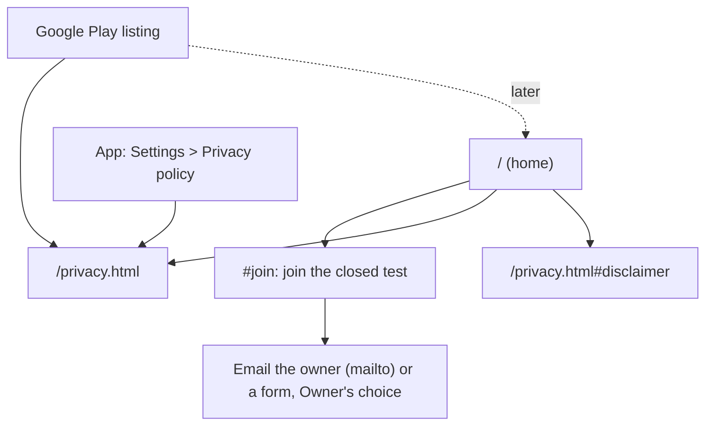

# Solent Companion website: design

A joint plan from the marketing team (Juno, Ivy, Echo, Rowan) and the product and UX team (Rex,
Nova, Pixel, Wren), written from the app repo's briefs:
`documents/competition-and-niche-opportunities.md`, `documents/design-and-development-plan.md`,
`documents/privacy-policy-draft.md` and `documents/release-and-play-console.md` in
[solent-companion-](https://github.com/theDoodleGuy/solent-companion-).

Date: 2026-10-19. Status: first version, built in this repo. Items marked **Owner** need a decision
or a detail from you.

---

## 1. Brief (Juno, with Rex)

### Objective

Get **20 Solent sailors into the closed test** before the season, then turn the site into the
app's home page when it reaches Google Play (target: before Easter 2027).

Why 20: Google needs at least 12 testers opted in for 14 days in a row before a personal account
can apply for production. Twenty means losing a few doesn't restart the clock.

### The site's three jobs, in order

1. **Sign up testers** for the closed test (now) and then send people to Google Play (later).
2. **Host the privacy policy** at a public URL. Google Play requires one, and the app links to it
   from Settings (`privacy_policy_url`).
3. **Earn trust** with sailors who will be sceptical of a new app touching their safety at sea:
   be specific about the Solent, say plainly what the app does not do, and show the working.

### Audience (from the research)

| Persona | What they need to see on the page |
|---|---|
| **Weekend Owner** (primary) | That it knows *their* water: Thorn Channel MPZ, Bramble Bank, Red Jets, VHF 12. That it sits alongside the chart app they already use. |
| **New Skipper** (primary) | That it shows the working: charted depth + height of tide − draft, the Day Skipper sum they learned. |
| **Charterer** (secondary) | A fast read on local hazards in an unfamiliar boat. |

Not for this site yet: racing crews, commercial skippers, Channel crossers.

### Positioning

> **The local knowledge your chart app doesn't have.**

A companion that works alongside savvy navvy, Navionics or paper charts, not a rival to them.
We never name competitors on the site; we describe the gap.

### Measures (checked fortnightly)

| Number | Target | How we count it |
|---|---|---|
| Tester sign-ups | 20 before the closed test starts | Emails received (owner's inbox or form) |
| Tester opt-ins on Play | 12+ for 14 days | Play Console |
| Privacy URL live | Before the first upload | The page loads at its public address |

No analytics on the site: it matches the app's promise (no tracking) and keeps the privacy page
honest. If we need visit counts later, use a cookieless, self-hosted counter and update the
privacy page first.

### What we're deliberately not doing

No blog, no newsletter, no paid ads, no social embeds, no cookie banner (nothing to consent to).
One page plus the privacy page is enough for a closed test.

---

## 2. Sitemap and flows (Nova)

### Home page, top to bottom

| # | Section | Job | Answers the visitor's question |
|---|---|---|---|
| 1 | **Header** | Name and one action | "Where am I?" |
| 2 | **Hero** | Positioning, who it's for, the main action, an app illustration | "What is this, and is it for me?" |
| 3 | **The three questions** | The problem in sailors' words: ships, notices, water | "Does it understand my problem?" |
| 4 | **Features** (four rows, alternating) | Ships and MPZ; tide gates with the working shown; notices on the map; Underway alerts | "What does it actually do?" |
| 5 | **Night mode and privacy strip** | Two short promises | "Will it ruin my night vision? Does it track me?" |
| 6 | **What it isn't** | The disclaimer, up front | "Can I trust it?" (Answer: trust it as an aid only.) |
| 7 | **Join the closed test** | What testers do, what they get, the sign-up action | "How do I get it?" |
| 8 | **FAQ** | iPhone? Cost? Which chart app? Data? | The objections left over |
| 9 | **Footer** | Privacy, disclaimer, contact, data credits | "Who's behind it?" |

### Interaction rules

- One primary action, repeated: **Join the closed test** (hero, after features, at the end).
  After launch it becomes **Get it on Google Play**.
- Works without JavaScript. The only script toggles the mobile menu, and the page reads fine if
  it doesn't run.
- Mobile first: most visitors arrive from a club WhatsApp group or forum on a phone.
- Every illustration has a text alternative that says what it shows, not "screenshot".
- Accessibility: WCAG 2.2 AA contrast, visible focus rings, a "Skip to content" link, 44 px
  minimum tap targets, respects `prefers-reduced-motion` and `prefers-color-scheme`.

### Sign-up flow (closed test)

1. Visitor taps **Join the closed test**.
2. Their mail app opens with a prefilled subject and a short template (Google account email,
   phone model, where they sail, boat type).
3. Owner adds them to the Play Console tester list and replies with the opt-in link.

**Owner:** a mailto link is the simplest start and needs no service. If you'd rather not show your
email, use a Google Form and paste its link in place of the mailto (one line in `index.html`,
marked `OWNER`). Either way, update the privacy page's sign-up section to match.

---

## 3. Words (Ivy and Wren)

Ivy writes the selling copy; Wren checks it against the app's copy deck so the site and the app use
the same words.

### Rules carried over from the app

- **Never "safe"**, "safer", "safety net" or "all clear". Use "advisory", "aid", "keep clear",
  "above / below your margin".
- Use the app's terms exactly: Moving Prohibited Zone (MPZ), height of tide, charted depth,
  clearance, margin, draft, Underway.
- Every claim matches the shipped app. No "real-time" (AIS can be minutes old; say "live, from
  AIS"), no numbers we can't back.
- No exclamation marks. Plain English; sailing terms only where sailors use them.

### Headline and supporting lines

- **H1:** The local knowledge your chart app doesn't have.
- **Sub:** Big ships and their Moving Prohibited Zones, tide gates and local notices for the
  Solent, in one free Android app that sits alongside the chart app you already use.
- **Primary action:** Join the closed test
- **Note under the action:** Android only. Free, no account, no ads.

The full copy is in `index.html` and `privacy.html`; those files are the copy deck.

### SEO metadata

| Page | Title (≤ 60) | Description (≤ 155) |
|---|---|---|
| Home | Solent Companion: ships, MPZs and tide gates for the Solent | A free Android companion for Solent sailors: big ships and their Moving Prohibited Zones, tide gates and local notices. Advisory only. |
| Privacy | Privacy policy and disclaimer · Solent Companion | What Solent Companion stores, what it fetches, and what it never sends. Your position stays on your phone. |

---

## 4. Visual design (Pixel)

The site borrows the app's visual system so the two look like one product: calm,
instrument-like, high contrast. "A good chartplotter, not a lifestyle app."

### Tokens (CSS custom properties in `assets/css/site.css`)

| Token | Light | Dark | From the app |
|---|---|---|---|
| `--surface` | #FFFFFF | #0B1D2A | `surface` |
| `--surface-alt` | #F2F6F9 | #102735 | new: section banding |
| `--text` | #0B1D2A | #E6EEF3 | `on-surface` |
| `--text-muted` | #3D5566 | #A9BBC7 | `on-surface-muted` |
| `--primary` | #0B5CAD | #6CB2F5 | `primary` |
| `--on-primary` | #FFFFFF | #0B1D2A | |
| `--alert` | #C21A1A | #FF6B60 | `status-alert` (MPZ) |
| `--caution` | #B25E00 | #F2A541 | `status-caution` (fast craft) |
| `--ok` | #0F6E4E | #4CC79B | `status-ok` (above margin) |
| `--notice` | #6A3FB0 | #B79CF0 | `notice-area` |
| `--night` | #000000 / #C4241C | same | night mode demo only |

All text pairs meet 4.5:1; large headings meet 3:1 at minimum, and most meet 7:1.

### Type, spacing and shape

- The system font stack: Roboto on Android (the app's family), San Francisco on Apple, Segoe on
  Windows. No web fonts, so no font requests to Google and nothing to declare on the privacy page.
  Tabular figures for every number.
- Fluid scale: body 17–18 px, H2 28–36 px, H1 36–56 px.
- Spacing scale from the app: 4, 8, 12, 16, 24, 32, 48, plus 64 and 96 for sections.
- Radius 16 for cards and the phone frame, 8 for chips. Flat; one soft shadow on the phone
  illustrations only.

### Imagery

- Until real screenshots exist (they need a MapTiler key), the site uses **SVG illustrations in
  the app's own map symbology**: a hull icon with its MPZ box and dashed padding, tide-gate
  shapes (circle and check, triangle and exclamation, square and question mark), a dashed notice
  polygon, and the red-on-black night palette.
- **Owner, later:** swap in real phone screenshots (Play listing ones work). Keep the alt text.
- Logo: the app's placeholder mark (sail over waves) on primary blue, as `assets/img/icon.svg`.
  Replace it when the final icon is designed.

---

## 5. Launch and growth (Rowan and Echo)

Rowan owns getting testers; Echo owns the posts that point at the site. Both follow each group's
rules: no link-dropping, and say plainly that you built it.

### Where Solent sailors are (Rowan's outreach list)

| Where | Ask | Notes |
|---|---|---|
| Your own club(s) | Notice-board post, a word at the bar, club WhatsApp | The research says test at your own club first. Best conversion. |
| Other Solent clubs (Hamble, Lymington, Cowes, Bosham, Portsmouth harbour clubs) | Ask the cruising secretary to share once in their newsletter | Offer a short talk on the MPZ in return. |
| RYA training centres in Hamble, Gosport, Southampton, Lymington | Let instructors try it; New Skippers are the second persona | "Show the working" is the hook. |
| YBW forum (Practical Boat Owner / Yachting Monthly community) | One honest thread asking for testers, then answer every reply | Check the forum's self-promotion rules first. |
| Facebook groups for Solent sailing and boat owners | One post per group, with the admin's OK | |

### Posts (Echo)

- **Hook for the MPZ:** "A ship coming up astern can put you inside its MPZ without you noticing.
  We built an Android app that draws the zone. Looking for 20 Solent sailors to test it."
- **Hook for tide gates:** "Bramble Bank at 14:30 with a 1.6 m draft: charted depth + height of
  tide − draft. The app shows the sum, not just the answer."
- Always end with the advisory line: "An aid, not a navigator: keep a lookout and monitor VHF 12."
- Image: the MPZ illustration from the site (**Owner, later:** a 1200 × 630 PNG social card made from
  `assets/img/hero-map.svg`, then add an `og:image` tag; link previews have no image until then).

### Launch checklist (Juno)

- [ ] **Owner:** choose the sign-up route (mailto with your address, or a Google Form link).
- [ ] **Owner:** turn on GitHub Pages (Settings > Pages > Source: GitHub Actions). The workflow
      in `.github/workflows/pages.yml` publishes the site on every push to `main`.
- [ ] **Owner:** review the privacy policy wording (the draft says "not legal advice"), fill in
      the server log retention and contact email, then set `privacy_policy_url` in the app to
      `https://<your-pages-address>/privacy.html`.
- [ ] Optional: a custom domain (add a `CNAME` file and set DNS).
- [ ] At Play launch: swap the closed-test actions for the Google Play badge and link.
